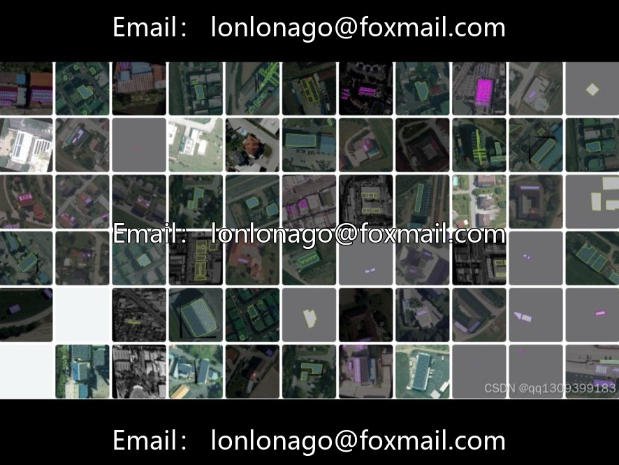
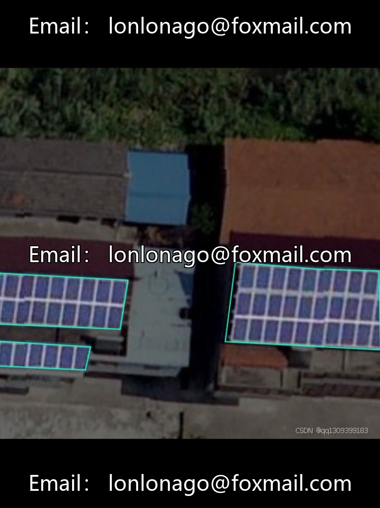
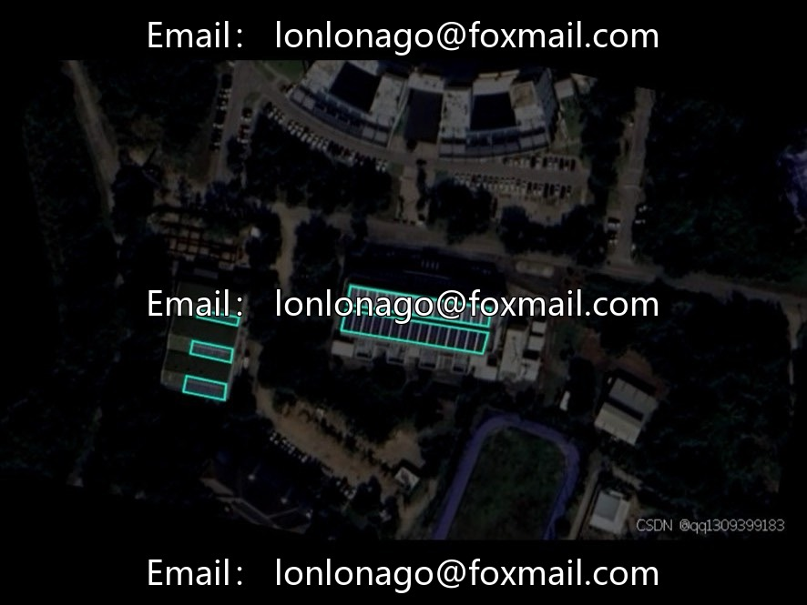

# Drone-photovoltaic panel aerial photography segmentation dataset | Issue 10069

## Body

Drone-photovoltaic panel aerial photography segmentation dataset | Issue 10069
For the perspective of drone aerial photography, this dataset focuses on the task of solar panel instance segmentation. The dataset contains 1586 high-resolution images, where each photo is individually boxed and labeled, with clear markings for edge shadows and stitching gaps, providing high-precision data support for solar power operation, grid planning, and environmental monitoring.

Dataset Highlights
· Task Type: Instance Segmentation, with pixel-level accuracy
· Total Images: 1586
· Scene Focus: Typical scenes such as rooftop photovoltaic arrays and desert photovoltaic power stations
· Annotation Details: Including fine-grained annotations like panel edge shadows and stitching gaps

Applicable task
Application direction, specific scenarios
Photovoltaic operation and maintenance automatically detects accumulated dust, cracks, hot spots, etc. on panels, replacing manual rooftop inspections.
Power grid planning: Quickly estimate the installed capacity of regional photovoltaic systems, assist in the decision-making process for energy distribution.
Environmental monitoring: Identifying whether photovoltaic power stations are illegally occupying arable land, distinguishing between panels and the land boundary.
Algorithm Research: Example segmentation model training, small object detection, adaptability to aerial photography perspective.

Virtual materials, once sold, are non-refundable.
Interested friends, click "I want" to proceed.

## Images

## Payment

Here is a pay link on Stripe ( https://buy.stripe.com/3cs8yP7sY87d0vu9AB ). Please contact me lonlonago@foxmail.com after funding $89, and I will send you a complete data files , thank you!

